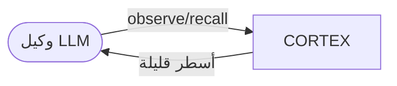

# المعمارية — CORTEX v0.2
1. **الأهداف والقيود** — دقة على الحقائق المتغيّرة · سياق ≤ 20 سطراً · زمن < 50ms · بلا GPU في v0.x.
2. **السياق (C4 L1)**

3. **الحاويات (C4 L2)** — مكتبة Python واحدة (`cortex/core2.py`) في الذاكرة؛ لا خوادم.
4. **المكوّنات (C4 L3)** — Gate (تشابه ≥ 0.95 يُرفض) · Store (خلايا + فهرس كيانات) · Supersede (نفس الكيانات + خانة متشابهة ≥ 0.35 ← حذف القديم) · Recall (تشابه + تعزيز كيانات + جسر قفزتين + انتشار) · Hebb (تقوية التنشيط المشترك).
5. **السيناريوهات** — تحديث رقم عميل: observe(جديد) ← Supersede يحذف القديم ← recall يعيد الجديد فقط.
6. **النشر** — مضمّن داخل عملية الوكيل.
7. **المفاهيم المشتركة** — استخراج الكيانات بقواعد (كلمات بحرف كبير/أرقام).
8. **المخاطر والدين التقني**
| الخطر | الاحتمال | الأثر | الخطة |
|---|---|---|---|
| الكيانات بالقواعد لا تعمل على العربية | عالٍ | عالٍ | M2: NER أو LLM لاستخراج الكيانات |
| الإلغاء يحذف حقيقة صحيحة | متوسط | عالٍ | أرشفة بدل حذف + اختبار |
| الضبط تم على نفس الاختبار | عالٍ | متوسط | hold-out في M3 |
| multihop 9% | — | متوسط | تفكيك السؤال في M3 |
9. **المصطلحات** — خلية = حقيقة واحدة · إلغاء = استبدال القديم بالجديد · خانة = كلمات الحقيقة بلا الكيانات والقيم.
